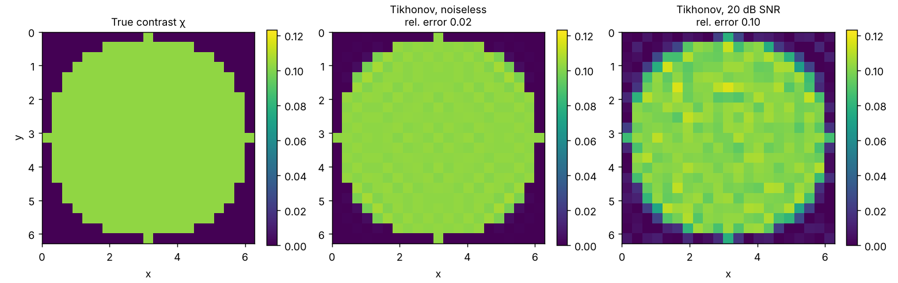

# Wavefield Imaging: Linearised Inverse Scattering

Reconstructing an unknown object from the waves it scatters. Line sources illuminate a 2-D domain,
receivers on a surrounding circle record the scattered field, and the object's **contrast function**
χ = (k/k_b)² − 1 is recovered from those measurements. This is the core idea behind microwave imaging,
seismic imaging and ultrasound tomography.



*Disc with k = 1.05 k_b; 8 sources, 150 receivers, 9 frequencies. Relative error: 1.7% noiseless,
10.4% at 20 dB SNR. Produced by `python wavefield_born.py`.*

## Method

1. **Forward model (Born approximation)**: for a weak scatterer, the total field inside the object is close
   to the incident field. That makes the scattered field linear in χ:

   u_sc(ρ_r) = k² h² Σₙ G(ρ_r, ρₙ) u_inc(ρₙ) χₙ, with G(r) = −(j/4) H₀⁽²⁾(kr) (the 2-D Helmholtz Green's function).

2. **System matrix**: stacking every source × frequency × receiver combination gives
   A ∈ ℂ^(10 800 × 441) on a λ/20 grid.
3. **Inversion**: the problem is ill-posed, because the singular values of A decay rapidly. It is regularised
   with
   - **Tikhonov**: χ̂ = (AᴴA + α σ₁² I)⁻¹ Aᴴ u (multi-frequency, `Wavefield_codes_v5.m`)
   - **Truncated SVD**: keep the 50 largest singular values (single frequency, `Wavefield_v7.m`)
4. **Noise study**: complex Gaussian noise at 20 dB SNR.

## Files

| File | Contents |
| --- | --- |
| `Wavefield_codes_v5.m` | Multi-source, multi-frequency Born inversion with Tikhonov regularisation |
| `Wavefield_v7.m` | Single-frequency version with TSVD and the singular-value spectrum |
| `wavefield_born.py` | Python/NumPy port of `Wavefield_codes_v5.m` (produces the figure above) |

## Running

```matlab
Wavefield_codes_v5   % or Wavefield_v7
```

```bash
pip install -r requirements.txt
python wavefield_born.py --save figures/born_reconstruction.png
```

Course project for Wavefield Imaging, MSc Electrical Engineering, TU Delft.
